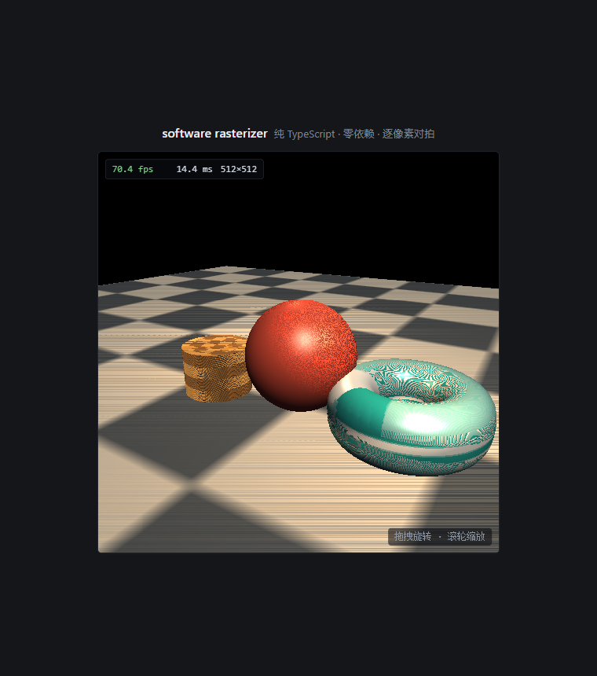
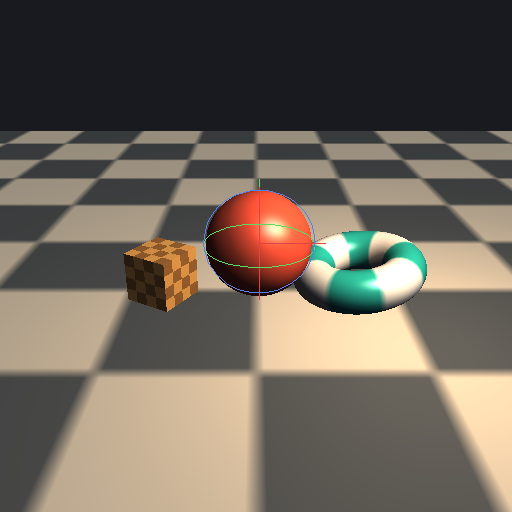
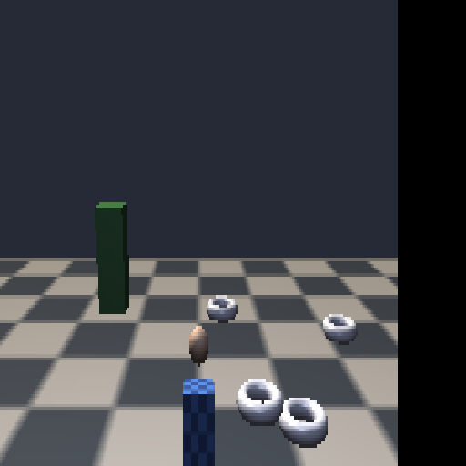

# rasterizer

纯 TypeScript 从零实现的 CPU 软件光栅器 **与小型 3D 引擎**：无 WebGL/WebGPU、运行时零 npm 依赖，黄金图逐像素对拍（容差 0）。二期已升级为场景图 + 材质系统 + 模型加载 + 关卡编辑器 + 演示游戏。

**在线入口**：<https://rasterizer.pages.dev>

- [3D Demo](https://rasterizer.pages.dev/index.html)（512×512，拖拽旋转 / 滚轮缩放）
- [关卡编辑器](https://rasterizer.pages.dev/editor.html)（场景树 / 拾取 / gizmo / 材质面板 / JSON 导入导出）
- [演示游戏「收集小径」](https://rasterizer.pages.dev/game.html)（第三人称 WASD 收集 10 个光环）





场景：双线性棋盘地面（透视校正 + mip）+ 程序化贴图立方体（nearest）+ Blinn-Phong 球 + 条纹环面，多光源（方向/点/聚光）+ 环境项，背面剔除开关 + 视锥剔除 + 近平面裁剪 + z-buffer + 不透明排序。

## 特性

| 模块 | 内容 |
|------|------|
| 数学 | 手写 Vec2/Vec3/Mat4（列主序、右手系、+Y 向上、GL 惯例透视 + 正交） |
| 光栅核心 | edge-function 逐像素直接求值 + top-left 规则（水密：共享边无缝隙无重叠） |
| 深度 | Float32 z-buffer，透视校正插值（`d = (Σλ·d/w)/(Σλ·1/w)`），同深度先画者赢 |
| 纹理 | 透视校正 uv，nearest + 双线性，repeat 环绕，mip 一档（逐三角形 texel 密度选层） |
| 着色 | Lambert / Blinn-Phong 开关；多光源数组：方向 + 点（二次衰减）+ 聚光（软锥）；Gouraud / Phong 两档 |
| 场景图 | 节点树（TRS 层级、可见性子树裁剪、DFS 展平），demo 迁移后与升级前黄金帧逐位一致 |
| 剔除 | 背面剔除开关 + 5 平面视锥剔除（包围球，像素安全）+ 近平面 Sutherland–Hodgman + 屏幕 guard |
| 模型 | OBJ 加载（v/vt/vn、四种索引形态、负索引、扇形三角化、几何法线兜底），零依赖 |
| 管线 | 透视/正交相机、不透明 front-to-back 排序（opt-in）、分辨率缩放（编辑器/游戏） |
| 编辑器 | 场景树、射线拾取（Möller–Trumbore）、移动/旋转 gizmo、材质面板、场景 JSON 导入导出（round-trip 逐像素一致） |
| 游戏 | 第三人称收集玩法：确定性布局、WASD、最短弧转向、计分/胜利/重开，纯 transform 插值动画（无骨骼） |
| Demo | 静态站三入口（demo / editor / game），512² rAF，HUD 帧率，分辨率缩放 |

## 快速开始

```bash
npm install        # 仅 devDependencies：typescript + @types/node
npm test           # 编译 + node:test 全量黄金图对拍（容差 0）
npm run typecheck  # tsc --noEmit
npm run demo       # 编译 demo + 本地静态服务器 http://127.0.0.1:8123/（/editor.html、/game.html）
npm run bench      # 512² 三角形吞吐基准（含 1 万三角形场景 + 分辨率扫描）
npm run golden     # 重新生成黄金图（参考实现，仅当有意变更参考实现时）
```

## 基准（Node v24.16.0，512²）

| 口径 | 结果 |
|------|------|
| `fillTriangleDepth` 屏幕空间填充（含 clear，中大型三角形，像素填充主导） | ≈17k tris/s |
| 完整管线 Phong（UV 球 48×24 = 2304 tris，约占屏一半） | ≈0.83M tris/s，2.8 ms/帧 |
| 演示场景整帧（4 物体 4622 tris，排序开，近距特写） | ≈19 ms/帧 ≈ 52 fps |
| **1 万三角形场景**（13 物体 9314 tris，剔除+排序+mip，满屏特写） | **16.3 ms/帧 ≈ 62 fps**（448² 78 / 384² 98 / 256² 172 fps） |
| 游戏（256² 内部分辨率，含合成） | 实测 150+ fps（vsync 前） |

复现：`npm run bench`。

## 测试策略（本项目最有趣的部分）

每个里程碑执行"参考实现先行"纪律：

1. **参考实现**（`tools/reference/gen_mX.ts`、`gen_p2_*.ts`）：自包含、独立编码的实现，生成 PPM(P6) 黄金图落盘并冻结；
2. **正式实现**（`src/`）：与黄金图逐像素 diff，**容差 0**；
3. **独立不变量**：黄金图之外的第三重证据 ——
   - M2：800 条种子随机无平局直线的双实现等价扫描 + 端点/连通性/贴近度性质测试；
   - M3：600 对相邻三角形拼矩形的**水密性扫描**（每像素中心恰覆盖一次）+ 解析覆盖计数；
   - M5：**光线-平面求交解析对拍**（>2000 像素逐位一致）+ "屏幕线性插值必偏离"敏感性断言；
   - M6：手工锚定的 Blinn-Phong 数值（轴对齐/半向量/衰减/背光）；
   - M7：0/1/2 三角形输出形状 + 交点插值精确性（`w` 恰落在 ε）；
   - 二期：聚光锥形因子手工锚定（轴上/45° 离轴/锥外/零轴/退化硬锥）、mip 选层阈值锚定（密度恰为 1）、OBJ 负索引与四索引形态、gizmo 拖拽增量锚定（28px → 1.09375 世界单位、90° 旋转）、**锚点黄金图**（升级前渲染一次性冻结,场景图迁移后逐位对拍）。

全部 116 个测试经 `npm test` 运行，任何历史黄金图都作为回归长期保留；21 张黄金图（一期 9 + 二期 12）。

二期收尾报告见 [REPORT.md](REPORT.md)（实现决策 / 验收对照 / 已知限制 / 博客素材）。

## 算法笔记

完整的关键决策与踩坑记录见 [docs/DEVLOG.md](docs/DEVLOG.md)，要点：

- **像素中心** `(i+0.5, j+0.5)`；屏幕 y 向下；三角形归一化到正有向面积后，`E==0` 的像素按 top-left 规则归属（left = `dy<0`，top = `dy==0 && dx>0`）—— 对共享边"总和且互斥"，保证水密。
- **逐像素直接求值**而非增量步进：黄金场景的"漂亮数"坐标存在精确 `E==0` 平局像素，增量累积会破坏精确零（试过，黄金图当场抓住）——确定性优先，实测性能仍然达标。
- **透视校正**一条公式同时管 uv 与深度：`(Σλ·a/w)/(Σλ·1/w)`；仿射绘制（invW≡1）是其特例，M4 的屏幕线性 z 黄金图因此全程保持回归有效。
- **背面剔除方向**：视空间 CCW 的前向面经投影 y 翻转后屏幕 area2 **< 0**（曾写反，渲染出球内壁）。
- **平局语义**：`d < depth` 严格小于只在深度逐位相同时保证先画者赢；常数 z 三角形的插值带 ULP 噪声 —— 用 2 的幂坐标构造逐位相同的平局来钉死语义。
- **整数指数平方链**替代 `Math.pow`：IEEE 上不逐位等价，但 8bit 量化后与黄金图无差异（黄金图为仲裁）。
- **场景图 TRS 结合序冻结**：`((T·Rz)·Ry)·Rx·S` 与旧 demo 的 compose 逐位一致是迁移零回退的基石（恒等旋转/缩放经矩阵乘不改变位型）。
- **视锥剔除只做 5 平面**：管线不裁远平面（远于 far 的几何仍被屏幕 guard 画出），按远平面剔除会改变像素；侧面/近平面外 ⇒ 0 像素,剔除是纯性能优化。
- **OBJ 负索引**相对"原始 v/vt/vn 指令列表"而非展开后的输出数组 —— 参考实现对拍抓住的第一版展开污染 bug。
- **不透明排序默认关**：深度逐位平局（如球与地面切点）时"先画者赢"会被排序翻转；无平局场景开/关逐像素一致（有测试）,编辑器/游戏显式开启。

## 目录

```
src/            正式实现（math/framebuffer/ppm/diff/rng/raster/texture/shading/clip/culling/obj/scenegraph/pipeline/scene + editor/ + game/）
demo/           静态站（index/editor/game.html + src/*.ts；js/ 为编译产物，不进 git）
tests/          node:test 测试（黄金对拍 + 解析/水密/等价扫描 + 锚定）
tools/          参考实现与黄金图生成器（gen_m1..m7、gen_p2_*）、ref_render.ts、bench、本地静态服务器
golden/         冻结的 PPM(P6) 黄金图（测试夹具，二进制）
tests/fixtures/ OBJ 测试夹具
docs/           DEVLOG（算法决策日志）、REPORT.md 与截图
```

## 部署

静态站托管于 Cloudflare Pages（生产分支 main → `rasterizer.pages.dev`，自定义域 raster.adcakeyuan.top）。
`wrangler pages deploy .deploy`，部署目录由 `npm run build:demo` 产物组装，不进 git。

---

一期 2025-10-25 · 二期 2026-11-15 · huqinyuan923-hue/rasterizer
