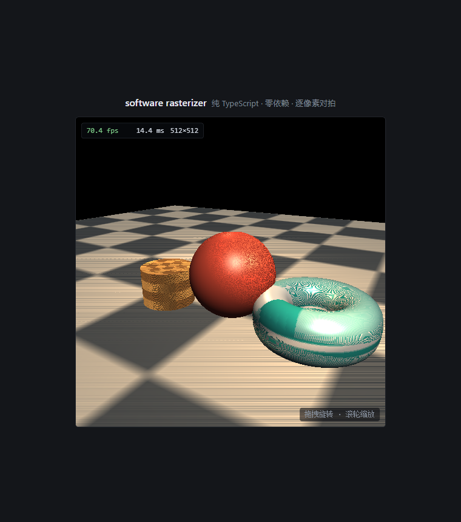

# rasterizer

纯 TypeScript 从零实现的 CPU 软件光栅器：无 WebGL/WebGPU、运行时零 npm 依赖，黄金图逐像素对拍（容差 0），带浏览器交互 Demo。

**在线 Demo：<https://rasterizer.pages.dev>**（512×512，实测 70+ fps，拖拽旋转 / 滚轮缩放）



场景：双线性棋盘地面（透视校正）+ 程序化贴图立方体（nearest）+ Blinn-Phong 球 + 条纹环面，方向光 + 轨道点光 + 环境项，背面剔除 + 近平面裁剪 + z-buffer。

## 特性

| 模块 | 内容 |
|------|------|
| 数学 | 手写 Vec2/Vec3/Mat4（列主序、右手系、+Y 向上、GL 惯例透视） |
| 光栅核心 | edge-function 逐像素直接求值 + top-left 规则（水密：共享边无缝隙无重叠） |
| 深度 | Float32 z-buffer，透视校正插值（`d = (Σλ·d/w)/(Σλ·1/w)`），同深度先画者赢 |
| 纹理 | 透视校正 uv（`u/w, v/w, 1/w`），nearest + 双线性，repeat 环绕 |
| 着色 | Lambert + Blinn-Phong；方向光 + 点光（二次衰减）+ 环境项；Gouraud / Phong 两档 |
| 裁剪 | 近平面 Sutherland–Hodgman（输出 0/1/2 个三角形）+ 屏幕边界 guard |
| 几何 | 程序化立方体 / UV 球 / 环面，程序化棋盘与条纹纹理（无外部资源） |
| Demo | 单页静态站，512² rAF，HUD 实时帧率，轨道相机 |

## 快速开始

```bash
npm install        # 仅 devDependencies：typescript + @types/node
npm test           # 编译 + node:test 全量黄金图对拍（容差 0）
npm run demo       # 编译 demo + 本地静态服务器 http://127.0.0.1:8123/
npm run bench      # 512² 三角形吞吐基准
npm run golden     # 重新生成黄金图（参考实现，仅当有意变更参考实现时）
```

## 基准（Node v24.16.0，512²）

| 口径 | 结果 |
|------|------|
| `fillTriangleDepth` 屏幕空间填充（含 clear，中大型三角形，像素填充主导） | ≈17k tris/s |
| 完整管线 Phong（UV 球 48×24 = 2304 tris，约占屏一半） | ≈0.9M tris/s，2.5 ms/帧 |
| 演示场景整帧（4 物体 4622 tris，不含 putImageData/合成） | ≈15 ms/帧 ≈ 67 fps |
| 有头 Chrome 实测整帧（含 putImageData + 合成） | 70–143 fps |

复现：`npm run bench`。

## 测试策略（本项目最有趣的部分）

每个里程碑执行"参考实现先行"纪律：

1. **参考实现**（`tools/reference/gen_mX.ts`）：自包含、独立编码的实现，生成 PPM(P6) 黄金图落盘并冻结；
2. **正式实现**（`src/`）：与黄金图逐像素 diff，**容差 0**；
3. **独立不变量**：黄金图之外的第三重证据 ——
   - M2：800 条种子随机无平局直线的双实现等价扫描 + 端点/连通性/贴近度性质测试；
   - M3：600 对相邻三角形拼矩形的**水密性扫描**（每像素中心恰覆盖一次）+ 解析覆盖计数；
   - M5：**光线-平面求交解析对拍**（>2000 像素逐位一致）+ "屏幕线性插值必偏离"敏感性断言；
   - M6：手工锚定的 Blinn-Phong 数值（轴对齐/半向量/衰减/背光）；
   - M7：0/1/2 三角形输出形状 + 交点插值精确性（`w` 恰落在 ε）。

全部 60 个测试经 `npm test` 运行，任何历史黄金图都作为回归长期保留。

## 算法笔记

完整的关键决策与踩坑记录见 [docs/DEVLOG.md](docs/DEVLOG.md)，要点：

- **像素中心** `(i+0.5, j+0.5)`；屏幕 y 向下；三角形归一化到正有向面积后，`E==0` 的像素按 top-left 规则归属（left = `dy<0`，top = `dy==0 && dx>0`）—— 对共享边"总和且互斥"，保证水密。
- **逐像素直接求值**而非增量步进：黄金场景的"漂亮数"坐标存在精确 `E==0` 平局像素，增量累积会破坏精确零（试过，黄金图当场抓住）——确定性优先，实测性能仍然达标。
- **透视校正**一条公式同时管 uv 与深度：`(Σλ·a/w)/(Σλ·1/w)`；仿射绘制（invW≡1）是其特例，M4 的屏幕线性 z 黄金图因此全程保持回归有效。
- **背面剔除方向**：视空间 CCW 的前向面经投影 y 翻转后屏幕 area2 **< 0**（曾写反，渲染出球内壁）。
- **平局语义**：`d < depth` 严格小于只在深度逐位相同时保证先画者赢；常数 z 三角形的插值带 ULP 噪声 —— 用 2 的幂坐标构造逐位相同的平局来钉死语义。
- **整数指数平方链**替代 `Math.pow`：IEEE 上不逐位等价，但 8bit 量化后与黄金图无差异（黄金图为仲裁）。

## 目录

```
src/            正式实现（math/framebuffer/ppm/diff/rng/raster/texture/shading/clip/pipeline/scene）
demo/           静态站（index.html + main.ts；js/ 为编译产物，不进 git）
tests/          node:test 测试（黄金对拍 + 解析/水密/等价扫描）
tools/          参考实现与黄金图生成器（gen_m1..m7）、bench、本地静态服务器
golden/         冻结的 PPM(P6) 黄金图（测试夹具，二进制）
docs/           DEVLOG（算法决策日志）与截图
```

## 部署

静态站托管于 Cloudflare Pages（生产分支 main → `rasterizer.pages.dev`）。
`wrangler pages deploy .deploy`，部署目录由 `npm run build:demo` 产物组装，不进 git。

---

构建于 2026-10-25 · huqinyuan923-hue/rasterizer
